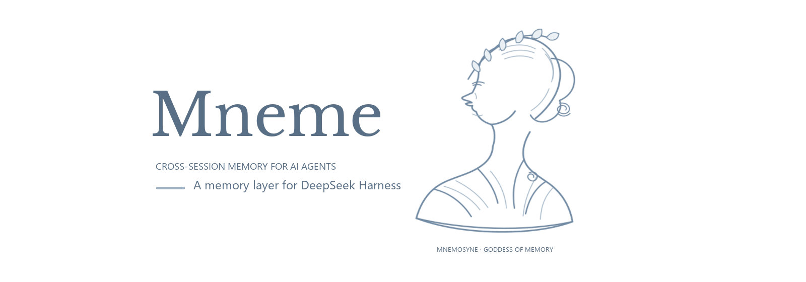

<p align="center">
  
</p>

<h1 align="center">dsh-mneme</h1>

<p align="center">
  <a href="https://www.npmjs.com/package/@modusensus/dsh-mneme"></a>
  <a href="https://www.npmjs.com/package/@modusensus/dsh-mneme"></a>
  <a href="LICENSE"></a>
  <a href="https://github.com/slow-stack/mneme/actions"></a>
  <a href="https://nodejs.org"></a>
  <a href="https://github.com/slow-stack/mneme"></a>
  <a href="https://codecov.io/gh/slow-stack/mneme"></a>
  <a href="https://github.com/awesome-dsh-plugin/awesome-dsh-plugin"></a>
</p>

<p align="center">🌏 <a href="#中文">简体中文</a> · <a href="#english">English</a></p>

---

<a name="中文"></a>

# 🧬 给 LLM 装上会自我进化的记忆

**dsh-mneme** 是 [DeepSeek Harness (DSH)](https://github.com/deepseek-ai/deepseek-harness) 的跨会话记忆插件。它不只「存得下」，更「管得好」：后台自动去重合并、矛盾先冻结等你裁决、全程可回放审计、记忆只落在本机，还支持导出成人可读的 Markdown。

> **Mneme**（Μνήμη）源自希腊记忆女神 **Mnemosyne**。她掌管记忆与梦境——正如 `autoDream` 在后台默默巩固你的记忆库。

## 📰 最近更新

| 日期 | 版本 | 头条 |
|------|------|------|
| 2026-10-21 | **v0.9.4** | **三条链各自补上「最后一环」** — 这一版的三件事同一种形状：东西早就造好了，只差没人能叫它。① **agent 主动整理**（[#231](https://github.com/slow-stack/mneme/issues/231)）：引擎在 v0.8 就落在 `src/organize.js`（先 dryRun 出比对报告 → agent 判断 → apply 落库，筛除只归档不删，全程复用 `dream_runs` 回执），可它**没有任何调用入口**——工具表里没有它、两张 API 脸 0 命中、全仓 `.organize(` 零调用点，只有测试能调到。现在它有工具了：`memory_organize`，`organizeEnabled` 默认关（关 = 工具根本不注册，模型看不到就不会调）。② **画像能被反向提取了**（[#497](https://github.com/slow-stack/mneme/issues/497)）：面板「用户画像」加一个按钮，读活跃记忆、花一次宿主模型调用，产一段「助手眼中的用户」**草稿**——**只出草稿**：采用是你在面板上再点一次，你手写的原文不会被模型改写；空库和模型不配合都直接报错，绝不回一张空草稿冒充「这次没提炼出东西」（`profileExtractEnabled` 默认关）。③ **人格不再无条件进别人的会话**：`default` 卡以前会落给所有没建卡的身份，于是宿主里自带身份的外部 bot 每一帧都收到两句「你是谁」撞在一起，而界面上「关掉这张卡」实际不生效——新增 `personaStrictAddressing`（默认关，历史行为逐字节不变）把「身份没建卡」与「卡被显式关掉」都收回到不注入。同版补上蒸馏的**转录围栏 + 解析失败护栏**（[#494](https://github.com/slow-stack/mneme/pull/494)：一条会话被同一个窗口卡死、重试 20 次越试越贵的根因；失败行现在恒带原始输出形状，事后能回答「模型到底吐了什么」），并把面板里那段自称「注入生效文本」的只读区改成由后端渲染——它以前既没有人格三行也没有表头和前缀，标题却承诺了模型实际看到的东西。 |
| 2026-10-20 | **v0.9.3** | **M.O. 从「挖得出来」跑到「会被叫去挖」** — 沉淀链的算法自 v0.9.1 起就写完了（多帧 zstd → 重复序列 → 缺席对照 → draft 草稿），可它在运行时**没有任何调用点**：全仓引用只出现在测试里。机器挖得出来、却永远不会被叫去挖——缺的从来不是算法，是**归属**与**触发**。这一版把三处接上：按会话头里的 `cwd` 反查项目桶（桶名是路径的**有损**变形，规则不在本仓，查不到就整跑跳过，而不是降级成全局普查——后者会把 A 项目的动作算到 B 头上，且结果看起来完全正常）；新增 `nudgeForProject` 把「归属 → 挖掘 → 落盘」收成一个入口；挂 `turn/end` 按项目跑，冷却 10 分钟、单次预算 4 秒、延到宏任务、一次一个项目、抛错只 `warn`。**它只产提议，不产草稿**（[#489](https://github.com/slow-stack/mneme/pull/489)）：升格仍然要人批，面板也多了「现在沉淀一次」，与自动跑同一条入口、区别只有不改仓库。同版修掉三处「坏了却不报」：作用域反查自 v0.8.0 起每次都抛错走降级、canonical 归一与成员校验静默失效（[#487](https://github.com/slow-stack/mneme/issues/487)）；`/nudge` 的写盘口只拦 `PUT`/`POST`，带 token 的 `PATCH`/`DELETE` 会静默写盘、归属解析不看预算、桶名边收边截把「没看全」报成「确实没有」；多帧 zstd 的反证断言绑了 Node 的整块解语义，24.22.0 起过期（[#490](https://github.com/slow-stack/mneme/pull/490)）。 |
| 2026-10-19 | **v0.9.2** | **让「看不见的失败」显形** — 这一版修的大多不是「缺功能」，是「坏了却不报」：功能开关一直是启动期生效，面板「已改」只说明值进了库，于是新增第三态「待重启」（[#481](https://github.com/slow-stack/mneme/pull/481)）；巩固的 `dreamMaxTokens` 默认值被原样当 `max_tokens` 发出去，撞上服务商上限后 180 次巩固 0 次成功，现在面板能改、超上限还会按服务商自己声明的上限自动降级（[#478](https://github.com/slow-stack/mneme/issues/478)）；自动蒸馏写入的行 100% 拿不到向量，注释承诺的「提交后补跑」从未存在（[#477](https://github.com/slow-stack/mneme/pull/477)）；CLI 把 `--` 开头的值当成新旗标——这个缺陷只在 token 前两位恰好掷中 `-`（约 1/4096）时现形，潜伏了整整一个发布周期。另新增作用域级可逆闸门（[#471](https://github.com/slow-stack/mneme/issues/471)，默认关）：让一路记忆能被单独按下与松开，不改配置、不重启。 |

> 只记大改动，逐条细节见 [CHANGELOG](dsh-mneme/CHANGELOG.md)。

## 它解决什么问题

每次新开对话，AI 都像第一次认识你？

**dsh-mneme 给 DeepSeek Harness 装上跨会话记忆。** 你聊过的项目、提过的偏好、做过的决定，AI 都记得——即使关掉了窗口，下次打开还在。

| 场景 | 没装插件 | 装了插件 |
|------|---------|---------|
| 周一聊完项目需求，周三继续 | "能再描述一下你的项目吗？" | "你指的是上周提到的博客重构吗？当时你说想用 Astro。" |
| 告诉 AI 你的编码习惯 | 每轮都要重复交代 | 一次设定，长期生效 |
| 整理大量资料后关窗口 | 资料丢了 | 自动归档，随时检索找回 |

> 但 dsh-mneme 的可信之处，恰恰在你**看不见**的后台。下面这些，才是它和「一个会存东西的插件」的本质区别。

## 为什么可以信任它

- 🧾 **可回放、可追责** — 每次自动整理都留一张「决策凭证」：输入快照 + 决策明细 + 结果哈希，同样的整理可复现回放，**不默默吞错、不留无法追溯的改动**。
- ⚖️ **矛盾先冻结，等你裁决**（可关）— 两条记忆打架时，不擅自替你做主。可疑冲突会**挂起待审**，状态页冲突队列里并排对比、一键裁决（保留 A / 保留 B / 仅标记），确认后才生效。复杂判断，人永远在线。
- 🔐 **记忆按 agent 与工作区隔离**（可关）— `scopeEnabled` 开启后，每条记忆标注由哪个 agent、在哪个工作区写入；检索时本会话作用域优先（命中加权，他 scope 降权仍可见）；`strictScope` 再进一步——**显式声明**收窄到他者作用域的记忆在检索/注入里完全不可见（载体自动标注只降权，不硬挡）。多 Agent、多项目互不串台。
- 🌙 **夜深人静才动手**（可关）— 空闲时自动分层归档：常看的留在热区、久不用的压成摘要、陈旧的彻底归档。记忆库**越用越精炼，不膨胀**。
- 🧠 **语义检索可以完全离线** — 把 `embedProvider` 设为 `local` 后检索走本地 Embedding 与精排，不需要 API Key；没配嵌入时关键词 / BM25 检索照样能用。
- 📝 **Markdown 双向同步** — 记忆就是本地 `.md` 文件，随时打开编辑；**人工改动会被优先尊重**，不会被机器覆盖。
- 💾 **删对话 ≠ 删记忆** — 记忆是跨会话的全局知识，清空聊天窗口，已保存的记忆仍在（v0.7.11 起不再与会话绑定）。

> **它和 Zep / Mem0 / Letta / Hindsight 比呢？** 有一张逐项对照表——存储底座、检索、写入时抽取、离线巩固、冲突处理、遗忘、作用域、可审计性、多宿主、离线、许可证共 11 行，**「—」不等于「差」**：[能力对比](docs/COMPARISON.md)。

## 5 分钟上手

```bash
# 安装插件（最省事的一条：npm 包名）
dsh plugin --profile web add @modusensus/dsh-mneme
dsh web
```

### 四种安装来源

DSH 的 **设置 → 插件 → Add plugin** 与 `dsh plugin add` 认四种写法，填进去的是什么就装什么。本仓库是个**单仓多包**：仓库根那份 `package.json` 只是**仓库壳**（`private`、不带 `dsh` 字段），真正可安装的插件本体在 `dsh-mneme/`。所以走 Git 或 tarball 时必须指到子目录，否则装到的是壳本身。

> 为什么仓库根要放一份装不了的壳？因为有些单仓多包探测器（比如 dshfind 的插件探测）只认仓库根的清单——没有它就会把本仓库判成「不可安装的插件包」，而这句判词与实际上能不能装无关。根清单 `private` + `0.0.0` + 不带 `dsh` 字段，就是为了让这类工具能找到子包、同时**绝不**被当成插件本体安装或发布。

| 来源 | 填什么 | 备注 |
|------|--------|------|
| **npm 包名** | `@modusensus/dsh-mneme` | 推荐；可带版本 `@0.9.0` |
| **Git 仓库** | `git+https://github.com/slow-stack/mneme.git#path:/dsh-mneme` | `#path:` 不可省。省掉装到的是仓库根那份壳（`0.0.0`、无 `dsh` 字段），宿主不会把它当插件 |
| **tarball** | `C:\\path\\to\\modusensus-dsh-mneme-0.9.0.tgz` | 在 `dsh-mneme/` 里 `npm pack` 产出；`pnpm pack` 会因 bin 脚本 CRLF 失败 |
| **本地目录** | `C:\\path\\to\\mneme\\dsh-mneme` | **必须是绝对路径**；相对路径会被宿主直接拒掉（`a local path must be absolute`） |

```bash
# 从源码装（本地目录，改完代码重启即生效）
git clone https://github.com/slow-stack/mneme.git
dsh plugin --profile web add "$(pwd)/mneme/dsh-mneme"

# 或者直接从 Git 装（不落源码，适合只要个能跑的版本）
dsh plugin --profile web add 'git+https://github.com/slow-stack/mneme.git#path:/dsh-mneme'
```

> 面板里那行「Install guide and examples」只演示了包名一种写法；上面四种都是实测通过的。Git 与 tarball 来源在安装时宿主会做一次仓库可达性检查（超时默认 5 秒）。

装完即可用。想在 5 分钟内看到它的价值：

1. **聊**：新开对话，跟 AI 聊几句关于你的偏好或手头项目（比如"我写代码更喜欢 4 空格缩进"）。
2. **等**：关掉窗口，重开新对话。如果它还记得刚才的事，说明记忆已经写入。
3. **调**：去「设置 → 记忆库设置」按需打开下面三个开关（见快速配置）。

## 快速配置（可选）

| 需求 | 配置项 | 默认值 | 改法 |
|------|--------|--------|------|
| 完全离线运行 | `embedProvider` | `openai` | 改为 `local` |
| 后台自动整理记忆 | `autoDream` | `true` | 改为 `false` 可关 |
| 自动提取结构化实体 | `entityExtractionEnabled` | `false` | 改为 `true` |
| 多 Agent / 多项目记忆隔离 | `scopeEnabled`（需要更强隔离再加 `strictScope`，硬隔离只对显式声明生效） | `false` | 改为 `true` |

> 以上均在 DSH 设置面板 → 记忆库设置 中修改。完整配置见 [配置章节](dsh-mneme/README.md)。

### 记忆库落点建议

记忆库默认在 `~/.dsh/memory`，天然在宿主 profile 作用域之外；但真实落点由 `memoryDir` 配置决定。若把它指进 profile 作用域（形如 `…/profiles/<名字>/…`），宿主清理或迁移 profile 时记忆库会被连带带走（#218 末楼记录的实际事故）。插件启动时检测到这种落点会打一条告警——**只提示、不搬库**。安全做法：`memoryDir` 保持在 profile 之外（默认值即可）；要迁移库 = 停止写入 → 复制整个目录 → 改配置指向新位置 → 重启。

## 一图看懂记忆闭环

```
  写入 ──► 质量过滤（无用信息先拦下）
    │
    ▼
  SQLite + 本地 Markdown 镜像
    │（空闲时）
    ├─ autoDream ：去重 / 合并 / 归档 / 修正 / 冲突冻结
    └─ Sleep Mode ：分层压缩 + 模式发现 + 关系补全（可关）
    │
    ▼
  召回（混合检索 + 精排）──► 注入会话上下文
```

## 🧭 M.O.：让「怎么做」也住进仓库（v0.9 beta）

记忆库记得住**为什么**这么做，但记不住**这件事到底怎么跑**。工作流住在哪，决定了它能不能被改：住在记忆库里是一行没有 diff 的文字，住在会话里是一次性的提示词，住在人脑里改不动也不留痕。

所以 v0.9 把它们搬进项目仓库——一条工作流一个文件：

```
<项目>/.mneme/pipelines/<id>.json     ← 项目层（能提交、能 diff、能 PR、能被 CI 读）
<插件包>/pipelines/<id>.json          ← 全局层（兜底，今天包里没有这个目录，这是有意的）
```

分工是一句话：**记忆是「为什么」，仓库是「怎么跑」，图是「看起来怎么样」**。

- **护栏，不是轨道** — 图上必须留一扇合法的逃生门：agent 判断这条路这次不对时，按风险档决定「记账先走」还是「停下问人」。跳过 = 这次不用这一步（≥3 次提议删这一步）；绕开 = 这条路整个不对（≥3 次提议重看这条路径）。**两个指标分开数**，混在一起两种提议都发不出来。
- **候选不进仓库** — 草稿住在 `<memoryDir>/candidates/<项目键>/`，只在本地。一天长十条死九条的东西进仓库就是垃圾。升格要同时满足「走过两次（至少一次成功）」**且**「写得出反事实」；够格之后系统只**提议**，提交与推送始终是人握着的那道门。
- **面板画的图和 agent 读的是同一份数据** — 只画不存，agent 就什么也读不到。节点状态（`refuted` / `trusted` / `stale` / `candidate`）全部从运行记录推，不由作者写死；今天还没有运行记录落点，所以全体恒为 `candidate`——这就是那个 beta 标签必须摆在脸上的原因。

默认关（`actionPipelineEnabled`）。设计取舍与踩过的坑见 [docs/WORKFLOWS.md](dsh-mneme/docs/WORKFLOWS.md)。

## 界面预览

> 面板内置中英双语，跟随你的 DSH 界面语言显示。以下为中文截图，英文版请切至文末 [English](#english) 段落。

<p align="center">
  <br/>
  <i>记录、浏览与筛选你的记忆。</i>
</p>

<p align="center">
  <br/>
  <i>自动从记忆里提炼实体，构建带属性的关系图谱。</i>
</p>

<p align="center">
  <br/>
  <i>状态面板一眼看清向量索引、LLM 消耗与自动巩固记录。</i>
</p>

<p align="center">
  <br/>
  <i>检索、实体抽取与记忆巩固开关都在设置里一站式配置。</i>
</p>

<p align="center">
  <br/>
  <i>可选写保护 Token，以及本地化的反馈通道，让记忆库完全本地、可审计。</i>
</p>

## 隐私承诺

- 记忆只落在本机：SQLite 存储 + 可手工编辑的 Markdown 镜像，不经过任何 mneme 服务器
- 记忆是 Markdown 文件，人类可读、可手工编辑
- 不需要 mneme 自己的 API Key；巩固与摘要走你已配置的宿主模型（`autoDream` / `autoSummarize` 默认开）
- 想连巩固也完全离线：把宿主换成本地模型（并清空 `dreamProvider` / `dreamModel` 与 `summarizeProvider` / `summarizeModel` —— 配了这两组就绕过宿主直连，换宿主不会生效），或直接关掉 `autoDream` / `autoSummarize`
- 无遥测、无分析、无远程日志

## 用在其他 AI 工具里（MCP）

插件自带零依赖 stdio MCP server（独立 npm 包 **`mneme-memory`**，bin 名 `mneme-mcp`），任何 MCP 客户端都能挂载记忆六件套（`memory_save` / `memory_search` / `memory_list` / `memory_get` / `memory_update` / `memory_delete`）。

**前置条件（一次性）**：

1. DSH 在运行且插件已安装（MCP 数据面走插件的独立 API `127.0.0.1:8790`）
2. 在 DSH 面板「设置 → 外部访问 API」生成 token

**各客户端挂载**（`<你的token>` 替换为上一步生成的值）：

| 客户端 | 挂载方式 |
|--------|---------|
| **Claude Code** | 项目根 `.mcp.json`：`{"mcpServers": {"mneme-memory": {"command": "mneme-mcp", "env": {"MNEME_TOKEN": "<你的token>"}}}}` |
| **Cursor** | 设置 → MCP → Add Server，command 填 `mneme-mcp`，env 加 `MNEME_TOKEN` |
| **Codex** | `~/.codex/config.toml`：`[mcp_servers.mneme-memory]` 段，`command = "mneme-mcp"`，`env = { MNEME_TOKEN = "<你的token>" }` |
| **Hermes** | `~/.hermes/config.yaml` 的 `mcp_servers:` 段：`mneme-memory: {command: "mneme-mcp", env: {MNEME_TOKEN: "<你的token>"}}`，重启生效 |
| **OpenCode** | `opencode.json`：`{"mcp": {"mneme-memory": {"type": "local", "command": ["mneme-mcp"], "environment": {"MNEME_TOKEN": "<你的token>"}}}}` |
| **OpenClaw** | `openclaw mcp add mneme-memory --command mneme-mcp --env MNEME_TOKEN=<你的token>`，或 Control UI → Settings → MCP |

> **旧挂载兼容**：已部署的 `dsh-mneme-mcp` + `DSH_MNEME_TOKEN` 写法继续有效（bin 与 env 变量均保留，无需迁移）。未全局安装 npm 包时，把 `command` 换成 `npx` 并追加参数 `-p mneme-memory mneme-mcp`（Claude Code/OpenCode 写进 args 数组，Codex 写 `args = ["-p", "mneme-memory", "mneme-mcp"]`）。配置细节与安全注意事项见[完整文档](dsh-mneme/README.md#mcp-server任意-mcp-客户端接入)。

## 不开 DSH 也能服务（独立服务 daemon）

`dsh-mneme-serve` 把记忆库跑成常驻数据面——DSH 关着，第三方集成（网页端桥接、脚本、自有面板）照样读写同一份记忆：token 与 DSH 面板/CLI 共用，路由与「外部访问 API」同源，端口被占直接报错（与 DSH 外部访问二选一）。第一期无 LLM（巩固/蒸馏仍属 DSH 宿主）；检索默认 local 嵌入（首次启动自动取件模型，`--embed off` 可关）。

```bash
npm i -g @modusensus/dsh-mneme
dsh-mneme-serve          # 默认 ~/.dsh/memory + 127.0.0.1:8790
```

## 社区适配器

社区项目把 mneme 接入更多平台——它们不是本仓库的一部分，兼容性由各自维护者跟进：

| 项目 | 平台 | 说明 |
|------|------|------|
| [Mneme-Bridge](https://github.com/SternChiri/Mneme-Bridge) | DeepSeek 网页端 | 浏览器扩展 + 本地服务：网页端会话蒸馏进 mneme 记忆库、DSH 侧记忆按话题回注，两侧共享同一份记忆。embedded（挂载 lib）与 remote（standalone API，不开 DSH 时配合上面的 daemon）双模式 |

> 想被收录？在 [Discussions](https://github.com/slow-stack/mneme/discussions) 开帖介绍你的项目，或直接提 PR 补充本表。

## 文档

| 文档 | 路径 |
|------|------|
| 插件完整文档（功能 / 安装 / 配置 / 架构） | [dsh-mneme/README.md](dsh-mneme/README.md) |
| stdio MCP server——Claude Code / Cursor 等任意 MCP 客户端接入记忆六件套 | [dsh-mneme/README.md · MCP Server](dsh-mneme/README.md#mcp-server任意-mcp-客户端接入) |
| 独立服务 daemon（不开 DSH 常驻数据面） | [dsh-mneme/docs/DAEMON.md](dsh-mneme/docs/DAEMON.md) |
| 配置说明（全键参考） | [dsh-mneme/docs/CONFIGURATION.md](dsh-mneme/docs/CONFIGURATION.md) |
| 蒸馏原文留存与记忆级溯源（#399） | [dsh-mneme/docs/DISTILL.md](dsh-mneme/docs/DISTILL.md) |
| 记忆分享包：出包与收包（`dsh-mneme share` / `receive` / `undo-share`） | [dsh-mneme/docs/SHARE.md](dsh-mneme/docs/SHARE.md) |
| 实体结构化设计 | [dsh-mneme/docs/ENTITIES.md](dsh-mneme/docs/ENTITIES.md) |
| 工作流（M.O.）：本体住仓库、证据住记忆库 | [dsh-mneme/docs/WORKFLOWS.md](dsh-mneme/docs/WORKFLOWS.md) |
| 语义架构 | [dsh-mneme/docs/SEMANTIC.md](dsh-mneme/docs/SEMANTIC.md) |
| 本地模型部署指南 | [dsh-mneme/docs/LOCAL_MODEL.md](dsh-mneme/docs/LOCAL_MODEL.md) |
| 与 Zep / Mem0 / Letta / Hindsight 的能力对比 | [docs/COMPARISON.md](docs/COMPARISON.md) |
| 版本历史 | [dsh-mneme/CHANGELOG.md](dsh-mneme/CHANGELOG.md) |
| 安全策略 | [SECURITY.md](SECURITY.md) |

## 🗺️ 路线图

```
🧬 记忆基因 → 🛡️ 审计加固 → 💤 睡眠维护 → 🕸️ 召回融合与图谱 → ✨ 面板增强 → 🌡️ 自进化记忆 → 🔐 作用域隔离 → 🌐 生态（MCP / daemon）→ 🧭 M.O.（项目级工作流）
```

| 版本 | 主题 | 状态 |
|------|------|------|
| **v0.3** | 记忆基因：实体 / 属性（带时间轴）/ 关系 | ✅ |
| **v0.4** | Sleep Mode：空闲四阶段深度维护 | ✅ |
| **v0.5** | 召回融合与记忆可视化：BM25 + 图谱 + 热记忆 | ✅ |
| **v0.6** | 会话生命周期：删对话 ≠ 删记忆 | ✅ |
| **v0.7** | 自进化记忆：热度衰减 + 睡眠双保护 + 桌面端工作台/功能开关 | ✅ |
| **v0.8** | 作用域隔离（agent/workspace 双维隔离 + 检索加权 + opt-in 硬过滤）+ 冲突队列人工裁决 + 归属显式声明 + 生态化（stdio MCP server / 图召回轴 / 冷启动 / 注入截断与状态条 / 蒸馏可靠性 / 注入形态与 agent 主动整理接口 / 配置说明与 issue 模板） | ✅ 已发布（至 v0.8.16） |
| **v0.9** | M.O.（Modus Operandi）beta：项目级工作流本体 + 候选分层与升格判据 + 面板清单/图同屏；设置面板按「新手之外」重划折叠线（#427）；安全审计与供应链加固（声明式路由鉴权、OSV 阻断、发布签名）；**v0.9.1 补上写侧**：执行窗口、运行账、归属候选、观察旁挂与脱节检出、步骤 `assert`/`optional`、沉淀链草稿挖掘、人格定义页（按 agent 多卡）；**v0.9.2 让看不见的失败显形**：功能开关第三态「待重启」、作用域级可逆闸门（#471）、巩固 `max_tokens` 超上限自动降级（#478）；**v0.9.3 接通自动沉淀**：按会话头 `cwd` 反查项目桶、挂 `turn/end`、冷却 10 分钟、单次预算 4 秒，只产提议不产草稿（#489），并修作用域反查自 v0.8.0 起静默降级（#487）、`/nudge` 写盘口漏拦 `PATCH`/`DELETE`、多帧 zstd 反证断言绑 Node 整块解语义（#490）；**v0.9.4 补上三条链的最后一环**：agent 主动整理接口有了工具（`memory_organize`，`organizeEnabled` 默认关，关时模型根本看不到它）、画像可以从记忆提取**草稿**（`profileExtractEnabled` 默认关，只出草稿、采用是用户再点一次，手写的原文不被模型改写）、人格 `default` 卡不再无条件进「没建卡」的身份（#497，`personaStrictAddressing` 默认关），面板那段「注入生效文本」改成由后端单源渲染，另补蒸馏转录围栏与解析失败护栏（#494） | ✅ 已发布（v0.9.4） |

> 完整逐小版本说明见 [CHANGELOG](dsh-mneme/CHANGELOG.md)。

## 🧪 本地开发

```bash
cd dsh-mneme && npm install
npm test        # 2302 个测试
npm run stress  # 三轴线压测
npm run sync    # src → lib 同步
```

---

## 🙏 致谢

autoDream 的理念溯源（理念借鉴、实现原创）：

- **[Claude Code 的 Auto Dream](https://code.claude.com/docs/en/memory)**（Anthropic，Memory 2.0）：理念源头——会话间隙由后台子代理整理记忆文件（去重、修矛盾、清衰减）。
- **[Sleep-time Compute: Beyond Inference Scaling at Test-time](https://arxiv.org/abs/2504.13171)**（UC Berkeley & Letta，arXiv:2504.13171）：Auto Dream「离线巩固」思想背后的学术脉络。
- **cc-haha**：早期实现思路的参照之一。

在上述工作之上，dsh-mneme 做了自己的工程发展：K-Means++ 聚类预分组、类型化决策清单（keep / merge / archive / conflict / update，及 sleep 侧 supersede / differentiate）与可回放的 sha256 摘要审计链（`dream_runs` / `receipt_chain`）。如有遗漏的灵感来源，欢迎提 issue 指出。

## 📚 相关研究

dsh-mneme 的机制设计与下列公开研究相互印证（以下引用均逐一核对过 arXiv 收录页；机制对应关系为我们自己的映射，非原论文观点）：

- **在线写入 + 离线巩固**：[Dual-Layer Agentic Memory with Fast Write Routing and Slow Consolidation](https://arxiv.org/abs/2608.22215)（arXiv:2608.22215）——与 autoDream 的「快写慢巩固」分工同构。
- **热度衰减与访问强化**：[FadeMem](https://arxiv.org/abs/2601.18642)（arXiv:2601.18642）——heat 记忆热度模型（指数衰减 × 访问强化 × 重要性调制）的学术近亲。
- **冲突裁决与状态追踪**：[StateMemBench](https://arxiv.org/abs/2608.19652)（arXiv:2608.19652）——记忆系统追踪演化状态的考卷；C1 冲突裁决（supersede 后不再引用旧值）以其为验收靶子。
- **何时该忘 / scope 门控**：[PersistBench](https://arxiv.org/abs/2602.01146)（arXiv:2602.01146）；呈现层缓解见 [Structured Memory](https://arxiv.org/abs/2608.08300)（arXiv:2608.08300）——scope 语义域门控的问题出处与零契约变更改法。
- **领域全景**：[Write–Manage–Read 综述](https://arxiv.org/abs/2603.07670)（arXiv:2603.07670）——「写入 / 管理 / 读取」三段式与插件整体形状互证。
- **数月尺度的可靠性工程**：[Memory as Infrastructure](https://arxiv.org/abs/2609.05510)（arXiv:2609.05510）——与 sha256 审计链、fail-safe 降级同属「记忆即基础设施」路线。
- **相邻系统（对照）**：[Zep](https://arxiv.org/abs/2501.13956)（时序知识图谱）、[Mem0](https://arxiv.org/abs/2504.19413)（生产级抽取式记忆）、[Hindsight](https://arxiv.org/abs/2512.12818)（retain / recall / reflect 三操作）走「写入时 LLM 抽取 + 向量/图检索」路线；dsh-mneme 的差异点在于：巩固由 LLM 参与但产物全程留痕可回放，冲突冻结待人工复核，记忆只落本机。

<a name="english"></a>

# 🧬 Give Your LLM a Memory That Evolves

**dsh-mneme** is a cross-session memory plugin for [DeepSeek Harness (DSH)](https://github.com/deepseek-ai/deepseek-harness). It does not just *store* your memories — it *manages* them: background deduplication and merging, conflicts frozen for your review, a fully replayable audit trail, memory kept on your machine, and export to human-readable Markdown.

> **Mneme** (Μνήμη) comes from **Mnemosyne**, the Greek goddess of memory and dreams — just as `autoDream` quietly consolidates your memory store in the background.

## 📰 Recent updates

| Date | Version | Headline |
|------|---------|----------|
| 2026-10-21 | **v0.9.4** | **Three chains each get their missing last link** — the three items in this release share one shape: the thing was already built, nothing could call it. ① **Agent-driven organizing** ([#231](https://github.com/slow-stack/mneme/issues/231)): the engine landed in `src/organize.js` back in v0.8 (dryRun comparison report → the agent decides → apply persists, screening out means archive rather than delete, every step leaving a `dream_runs` receipt), but it had **no entry point at all** — absent from the tool table, zero hits on both API surfaces, zero `.organize(` call sites in the repo; only its own tests could reach it. Now it has a tool: `memory_organize`, behind `organizeEnabled`, off by default (off = the tool is not even registered, so a model that cannot see it never calls it). ② **The profile can finally be derived** ([#497](https://github.com/slow-stack/mneme/issues/497)): the panel's profile card gained a button that reads the active memories, spends one host model call and returns an "as the assistant sees them" **draft** — **a draft only**: applying it is another click you make, and your hand-written text is never rewritten by the model; an empty store or a misbehaving model is an error, never an empty draft masquerading as "nothing to extract this time" (`profileExtractEnabled`, off by default). ③ **Personas no longer leak into someone else's session**: the `default` card used to be handed to every identity without a card, so a third-party bot running in the same host — one that carries its own identity — received two "you are ..." claims in every turn, while "switch this card off" in the panel changed nothing; the new `personaStrictAddressing` (off by default, existing behaviour byte-identical) reclaims both "no card for this identity" and "card explicitly switched off" as inject-nothing. The same release adds the **transcript fence and the parse-failure guard** for distillation ([#494](https://github.com/slow-stack/mneme/pull/494): the root cause of one session being stuck on the same window, retried 20 times and growing more expensive each time; failed rows now always carry the raw output shape, so "what did the model actually print" is answerable afterwards), and the panel's read-only card that called itself "injected text" is now rendered by the backend — it used to show neither the persona lines nor the header and prefix it claimed to mirror. |
| 2026-10-20 | **v0.9.3** | **M.O. goes from “diggable” to “actually summoned to dig”** — the distillation chain has been fully implemented since v0.9.1 (multi-frame zstd → repeated sequences → absence contrast → draft workflows), yet it had **no call site at runtime**: every reference in the repo lived in tests. The machine could dig, but nothing ever called it. What was missing was never the algorithm — it was **attribution** and **triggering**. This release wires up three things: resolving a project's session bucket from the `cwd` in the session header (bucket names are a **lossy** transform of paths whose rule lives outside this repo; when the lookup fails the whole run is skipped rather than degraded into a global sweep — the latter attributes project A's actions to project B, and the result looks perfectly normal); a new `nudgeForProject` that folds “attribute → mine → persist” into one entry point; and a `turn/end` hook that runs per project with a 10-minute cooldown, a 4-second budget, deferred to a macrotask, one project at a time, errors only warned. **It produces proposals, never drafts** ([#489](https://github.com/slow-stack/mneme/pull/489)): promotion still needs a human, and the panel gained a "distill now" button on the same entry point, differing only in that it does not touch the repo. The same version fixes three “broken but silent” defects: the scope reverse-lookup that had been throwing and silently degrading on every call since v0.8.0, disabling canonical normalization and membership checks ([#487](https://github.com/slow-stack/mneme/issues/487)); `/nudge`'s write gate, which only intercepted `PUT`/`POST` so a token-bearing `PATCH`/`DELETE` persisted proposals silently, plus attribution resolution ignoring the budget and bucket names being truncated while being collected — reporting “did not look at everything” as “there is genuinely nothing”; and a multi-frame zstd counter-assertion bound to Node's whole-buffer decode semantics, expired from 24.22.0 ([#490](https://github.com/slow-stack/mneme/pull/490)). |
| 2026-10-19 | **v0.9.2** | **Making silent failures visible** — most of what this release fixes isn't a missing feature, it's something broken that never said so. Feature flags have always taken effect at startup, so a lit "changed" badge only meant the value reached the database; there's now a third state, **pending restart** ([#481](https://github.com/slow-stack/mneme/pull/481)). The default `dreamMaxTokens` was sent verbatim as `max_tokens` and blew past provider caps: **180 consolidations, 0 successes** over eight days — the panel can now edit it, and an over-cap request retries once at the limit the provider itself declares ([#478](https://github.com/slow-stack/mneme/issues/478)). Rows written by auto-distillation got no vector at all; the "deferred to commit" the comment promised never existed ([#477](https://github.com/slow-stack/mneme/pull/477)). And the CLI treated values starting with `--` as new flags — a defect that only surfaces when a random token happens to begin with `-` (about 1/4096), which is why it hid for a whole release cycle. Also new: a **scope-level reversible gate** ([#471](https://github.com/slow-stack/mneme/issues/471), off by default) that pauses one scope without editing config or restarting. |

> Headlines only; see the [CHANGELOG](dsh-mneme/CHANGELOG.md) for the full list.

## What problem does it solve

Every time you start a new chat, the AI acts like it's never met you?

**dsh-mneme gives DeepSeek Harness cross-session memory.** Projects you've discussed, preferences you've mentioned, decisions you've made — the AI remembers them even after you close the window.

| Scenario | Without plugin | With plugin |
|----------|---------------|-------------|
| Continue a project discussion from Monday on Wednesday | "Can you describe your project again?" | "You mean the blog refactor from last week? You mentioned wanting to use Astro." |
| Tell the AI your coding habits | Repeat every session | Set once, remember forever |
| Close window after organizing research | Notes are lost | Auto-archived, retrievable anytime |

> But what makes dsh-mneme trustworthy lives in the background you never see. These are the traits that set it apart from "a plugin that just saves things."

## Why you can trust it

- 🧾 **Replayable, accountable** — every consolidation leaves a "decision receipt": input snapshot + decision detail + result hash. The same run reproduces the same outcome. **No silent mis-merges, no untraceable changes.**
- ⚖️ **Conflicts freeze, you decide** (opt-in) — when two memories contradict, it does not take sides for you. The suspected conflict is **parked for review**, compared side-by-side in the status-page conflict queue, and resolved with one click (keep A / keep B / mark reviewed). On hard judgments, a human stays in the loop.
- 🔐 **Memories isolated by agent & workspace** (opt-in) — with `scopeEnabled`, every memory is stamped with which agent wrote it and in which workspace; retrieval favors the current scope (weighted hits, out-of-scope demoted but visible); `strictScope` goes further — memories **explicitly** scoped to other agents/workspaces become invisible to search and injection (auto carrier labels are demoted only, never hard-blocked). Multiple agents and projects, zero cross-talk.
- 🌙 **It works while you sleep** (opt-in) — idle time triggers tiered archiving: frequent memories stay hot, stale ones compress to summaries, old ones archive. The store **stays lean as it grows**.
- 🧠 **Semantic search that can run fully offline** — set `embedProvider` to `local` and retrieval uses local embedding + reranking, no API key needed; without an embedder, keyword / BM25 retrieval still works.
- 📝 **Two-way Markdown sync** — memories are local `.md` files you can open and edit; **human edits are respected**, never clobbered by the machine.
- 💾 **Delete the session ≠ delete the memory** — memories are cross-session global knowledge; clearing a chat window keeps what was saved (unbound from sessions since v0.7.11).

> **How does it compare with Zep / Mem0 / Letta / Hindsight?** There is a row-by-row table — storage, retrieval, write-time extraction, offline consolidation, conflicts, forgetting, scoping, auditability, multi-host, offline, license: 11 rows, and **"—" does not mean "worse"**: [capability comparison](docs/COMPARISON.md) (Chinese).

## 5-minute quickstart

```bash
# Install the plugin (the easy path: npm package name)
dsh plugin --profile web add @modusensus/dsh-mneme
dsh web
```

### Four install sources

**Settings → Plugins → Add plugin** and `dsh plugin add` accept four kinds of spec — whatever you paste is what gets installed. This repository is a **multi-package repo**: the `package.json` at the root is only a **repo shell** (`private`, no `dsh` field), while the installable plugin lives in `dsh-mneme/`. So Git and tarball specs must point at that subdirectory; otherwise you install the shell itself.

> Why ship an uninstallable shell at the repo root? Because some multi-package detectors (dshfind's plugin probe, for one) only look at the root manifest — without it this repository is judged "not an installable plugin package," which says nothing about whether it actually installs. The root manifest is `private` + `0.0.0` + carries no `dsh` field precisely so such tools can find the real subpackage while it can **never** be installed or published as the plugin itself.

| Source | Paste this | Note |
|--------|-----------|------|
| **npm name** | `@modusensus/dsh-mneme` | Recommended; a version range works too (`@0.9.0`) |
| **Git repo** | `git+https://github.com/slow-stack/mneme.git#path:/dsh-mneme` | `#path:` is not optional. Without it you get the root shell (`0.0.0`, no `dsh` field) — the host does not treat it as a plugin |
| **tarball** | `C:\\path\\to\\modusensus-dsh-mneme-0.9.0.tgz` | Produced by `npm pack` inside `dsh-mneme/`; `pnpm pack` fails on the bin script's CRLF line endings |
| **local directory** | `C:\\path\\to\\mneme\\dsh-mneme` | **Must be absolute** — a relative path is rejected outright (`a local path must be absolute`) |

```bash
# From source (local directory; edit code, restart, done)
git clone https://github.com/slow-stack/mneme.git
dsh plugin --profile web add "$(pwd)/mneme/dsh-mneme"

# Or straight from Git (no checkout; good for just running a version)
dsh plugin --profile web add 'git+https://github.com/slow-stack/mneme.git#path:/dsh-mneme'
```

> The "Install guide and examples" panel only demonstrates the npm form; all four above are verified. Git and tarball sources get one repository-reachability check at install time (5-second timeout by default).

It works out of the box. To feel its value in five minutes:

1. **Chat** — start a session and tell the AI something about your preferences or a project (e.g. "I prefer 4-space indentation.").
2. **Verify** — close the window, open a new one. If it recalls what you said, the memory has landed.
3. **Tune** — open **Settings → Memory Settings** and flip the three switches below as needed.

## Quick config (optional)

| Need | Config key | Default | Change |
|------|-----------|---------|--------|
| Fully offline | `embedProvider` | `openai` | Change to `local` |
| Background consolidation | `autoDream` | `true` | Change to `false` to disable |
| Structured entity extraction | `entityExtractionEnabled` | `false` | Change to `true` |
| Memory isolation per agent / workspace | `scopeEnabled` (add `strictScope` for stronger isolation — hard blocking applies to explicit declarations only) | `false` | Change to `true` |

> All of these live in DSH Settings → Memory Settings. Full config docs in the [Configuration section](dsh-mneme/README.md) (Chinese, bilingual file).

### Where to put the memory library

The library defaults to `~/.dsh/memory`, which is naturally outside any host profile scope; the actual location follows your `memoryDir` config. If it points inside a profile scope (a path like `…/profiles/<name>/…`), the library is taken away along with the profile when the host cleans or migrates it (an actual incident recorded in #218). The plugin logs a warning at startup when it detects such a location — **advisory only, it never moves your data**. Safe practice: keep `memoryDir` outside profiles (the default already is); to migrate, stop writing → copy the whole directory → point the config at the new location → restart.

## The memory loop in one diagram

```
  write ──► quality filter (drop noise first)
    │
    ▼
  SQLite + local Markdown mirror
    │ (when idle)
    ├─ autoDream   : dedupe / merge / archive / fix / freeze-conflict
    └─ Sleep Mode  : tiered compression + pattern discovery + relation completion (opt-in)
    │
    ▼
  recall (hybrid search + rerank) ──► inject into the conversation
```

## 🧭 M.O.: make "how it's done" live in the repo (v0.9 beta)

The memory store remembers **why** a thing was done that way, but not **how the thing actually runs**. Where a workflow lives decides whether it can be changed at all: as a line in the memory store it has no diff; as a session prompt it exists once; in someone's head it can't be edited and leaves no trace.

So v0.9 moves workflows into the project repository — one file per workflow:

```
<project>/.mneme/pipelines/<id>.json   ← project layer (commit, diff, PR, readable by CI)
<plugin>/pipelines/<id>.json           ← global layer (fallback; the package ships none today, on purpose)
```

One sentence of division of labour: **memory is the "why", the repo is the "how", the graph is the "what it looks like"**.

- **Guardrails, not tracks** — the graph must leave a legal escape hatch: when the agent judges this path wrong *this time*, the risk tier decides whether it goes ahead and records it, or stops and asks. *Skipped* means this step wasn't needed (≥3 times → propose deleting the step); *bypassed* means the whole path was wrong (≥3 times → propose revisiting the path). **Counted separately** — merged together, neither proposal can ever fire.
- **Candidates never enter the repo** — drafts live in `<memoryDir>/candidates/<project-key>/`, local only. Ten a day, nine dead: in the repo that's just garbage. Promotion requires **both** "walked twice (at least once successfully)" and "can state the counterfactual"; even then the system only *proposes* — commit and push stay a human gate.
- **The panel and the agent read the same data** — render-only means the agent reads nothing. Node states (`refuted` / `trusted` / `stale` / `candidate`) are derived from run records, never authored; there is no run-record sink yet, so every node is `candidate` — which is exactly why that beta label has to be on the surface.

Off by default (`actionPipelineEnabled`). Design trade-offs and pitfalls: [docs/WORKFLOWS.md](dsh-mneme/docs/WORKFLOWS.md) (Chinese).

## Screenshots

> The panel is bilingual and follows your DSH interface language. English shots below; see the [Chinese](#中文) section for the localized UI.

<p align="center">
  <br/>
  <i>Record, browse and filter your memories.</i>
</p>

<p align="center">
  <br/>
  <i>Entities are extracted from your memories, building a relation graph with attributes.</i>
</p>

<p align="center">
  <br/>
  <i>The status panel shows your vector index, LLM spend and consolidation activity at a glance.</i>
</p>

<p align="center">
  <br/>
  <i>Retrieval, entity extraction and consolidation toggles are all configured in one place.</i>
</p>

<p align="center">
  <br/>
  <i>Optional write-protect token and feedback channels for a fully local, auditable setup.</i>
</p>

## Privacy

- Memories stay on your machine: a local SQLite store plus editable Markdown mirrors, with no mneme server in the path
- Memories are Markdown files, human-readable and editable
- No mneme API key required; consolidation and summarization use the host model you already configured (`autoDream` / `autoSummarize` are on by default)
- Want consolidation fully offline too? Point the host at a local model **and** clear `dreamProvider` / `dreamModel` plus `summarizeProvider` / `summarizeModel` (setting those routes talks straight to that provider, so switching the host alone will not help) — or just turn off `autoDream` / `autoSummarize`
- No telemetry, no analytics, no remote logging

## Use it in other AI tools (MCP)

The plugin ships a zero-dependency stdio MCP server (standalone npm package **`mneme-memory`**, bin `mneme-mcp`). Any MCP client can mount the six memory tools (`memory_save` / `memory_search` / `memory_list` / `memory_get` / `memory_update` / `memory_delete`).

**One-time prerequisites**:

1. DSH is running with the plugin installed (the MCP data plane goes through the plugin's standalone API at `127.0.0.1:8790`)
2. Generate a token in the DSH panel under **Settings → External API**

**Per-client setup** (replace `<your-token>` with the value from the previous step):

| Client | Setup |
|--------|-------|
| **Claude Code** | Project-root `.mcp.json`: `{"mcpServers": {"mneme-memory": {"command": "mneme-mcp", "env": {"MNEME_TOKEN": "<your-token>"}}}}` |
| **Cursor** | Settings → MCP → Add Server; command `mneme-mcp`, env `MNEME_TOKEN` |
| **Codex** | `~/.codex/config.toml`: `[mcp_servers.mneme-memory]` section, `command = "mneme-mcp"`, `env = { MNEME_TOKEN = "<your-token>" }` |
| **Hermes** | `mcp_servers:` section of `~/.hermes/config.yaml`: `mneme-memory: {command: "mneme-mcp", env: {MNEME_TOKEN: "<your-token>"}}`, then restart |
| **OpenCode** | `opencode.json`: `{"mcp": {"mneme-memory": {"type": "local", "command": ["mneme-mcp"], "environment": {"MNEME_TOKEN": "<your-token>"}}}}` |
| **OpenClaw** | `openclaw mcp add mneme-memory --command mneme-mcp --env MNEME_TOKEN=<your-token>`, or Control UI → Settings → MCP |

> **Legacy mounts keep working**: `dsh-mneme-mcp` + `DSH_MNEME_TOKEN` remain supported (both the bin and env vars are preserved; no migration needed). If the npm package is not installed globally, use `npx` as the command with args `-p mneme-memory mneme-mcp` (an args array in Claude Code/OpenCode; `args = ["-p", "mneme-memory", "mneme-mcp"]` in Codex). Full config details and security notes: [full docs](dsh-mneme/README.md#mcp-server任意-mcp-客户端接入) (Chinese).

## Serve memories without DSH (standalone daemon)

`dsh-mneme-serve` runs the memory store as a long-lived data plane — with DSH closed, third-party integrations (web-bridge tools, scripts, your own panels) still read and write the same memories: the Bearer token is shared with the DSH panel/CLI, routes mirror the external API, and a busy port is a hard error (pick either the daemon or DSH's external API, not both). Phase 1 is LLM-free (consolidation/distillation stay with the DSH host); retrieval defaults to local embeddings (runtime + model auto-provisioned on first boot, `--embed off` to disable).

```bash
npm i -g @modusensus/dsh-mneme
dsh-mneme-serve          # defaults: ~/.dsh/memory + 127.0.0.1:8790
```

## Community adapters

Community projects that wire mneme into more platforms — not part of this repository; compatibility is tracked by their maintainers:

| Project | Platform | Description |
|---------|----------|-------------|
| [Mneme-Bridge](https://github.com/SternChiri/Mneme-Bridge) | DeepSeek web | Browser extension + local service: web chats are distilled into the mneme store and DSH memories are injected back by topic, so both sides share one memory. Embedded (mounts the lib) and remote (standalone API — pairs with the daemon above) modes |

> Want your project listed? Open a Discussion or send a PR adding a row to this table.

## Docs

| Doc | Path |
|-----|------|
| Full plugin docs (features / install / config / architecture) | [dsh-mneme/README.md](dsh-mneme/README.md)（中文） |
| stdio MCP server — plug the six memory tools into any MCP client (Claude Code / Cursor / …) | [dsh-mneme/README.md · MCP Server](dsh-mneme/README.md#mcp-server任意-mcp-客户端接入)（中文） |
| Standalone daemon (serve memories without DSH) | [dsh-mneme/docs/DAEMON.md](dsh-mneme/docs/DAEMON.md)（中文） |
| Configuration reference (all keys) | [dsh-mneme/docs/CONFIGURATION.md](dsh-mneme/docs/CONFIGURATION.md)（中文） |
| Distill record retention & memory-level provenance (#399) | [dsh-mneme/docs/DISTILL.md](dsh-mneme/docs/DISTILL.md)（中文） |
| Memory share pack: export and import (`dsh-mneme share` / `receive` / `undo-share`) | [dsh-mneme/docs/SHARE.md](dsh-mneme/docs/SHARE.md)（中文） |
| Entity structure design | [dsh-mneme/docs/ENTITIES.md](dsh-mneme/docs/ENTITIES.md) |
| Workflows (M.O.): the workflow lives in the repo, the evidence in memory | [dsh-mneme/docs/WORKFLOWS.md](dsh-mneme/docs/WORKFLOWS.md)（中文） |
| Semantic architecture | [dsh-mneme/docs/SEMANTIC.md](dsh-mneme/docs/SEMANTIC.md) |
| Local model guide | [dsh-mneme/docs/LOCAL_MODEL.md](dsh-mneme/docs/LOCAL_MODEL.md) |
| Capability comparison vs Zep / Mem0 / Letta / Hindsight | [docs/COMPARISON.md](docs/COMPARISON.md)（中文） |
| Changelog | [dsh-mneme/CHANGELOG.md](dsh-mneme/CHANGELOG.md) |
| Security | [SECURITY.md](SECURITY.md) |

## 🗺️ Roadmap

```
🧬 Gene → 🛡️ Audit hardening → 💤 Sleep maintenance → 🕸️ Recall fusion & graph → ✨ Panel enhancement → 🌡️ Self-evolving memory → 🔐 Scope isolation → 🌐 Ecosystem (MCP / daemon) → 🧭 M.O. (project-level workflows)
```

| Version | Theme | Status |
|---------|-------|--------|
| **v0.3** | Gene: entities / time-boxed attributes / relations | ✅ |
| **v0.4** | Sleep Mode: idle 4-phase deep maintenance | ✅ |
| **v0.5** | Recall fusion & visualization: BM25 + graph + hot memory | ✅ |
| **v0.6** | Session lifecycle: delete session ≠ delete memory | ✅ |
| **v0.7** | Self-evolving memory: heat decay + sleep dual-protection + desktop workbench/feature toggles | ✅ |
| **v0.8** | Scope isolation (agent/workspace stamping + retrieval weighting + opt-in hard filter) + conflict review queue + explicit attribution + ecosystem (stdio MCP server / graph recall axis / cold-start bootstrap / injection truncation & status bar / distill reliability / injection shaping & agent-driven organize / configuration reference & issue templates) | ✅ Released (up to v0.8.16) |
| **v0.9** | M.O. (Modus Operandi) beta: project-level workflows + candidate tiering & promotion criteria + panel list-and-graph view; settings panel re-folded at "beyond the newcomer" (#427); security & supply-chain hardening (declarative route auth, OSV gate, signed releases); **v0.9.1 adds the write side**: execution windows, run ledger, attribution candidates, observation sidecar with drift detection, step `assert`/`optional`, draft mining from session logs, persona page (per-agent cards); **v0.9.2 makes silent failures visible**: feature-flag third state "pending restart", scope-level reversible gate (#471), automatic max_tokens downgrade for consolidation (#478); **v0.9.3 wires up auto-distillation**: resolves the project bucket from the session header's `cwd`, hooks `turn/end`, 10-minute cooldown, 4-second budget, proposals only and never drafts (#489), and fixes the scope reverse-lookup that had been silently degrading since v0.8.0 (#487), the `/nudge` write gate missing `PATCH`/`DELETE`, and a multi-frame zstd counter-assertion bound to Node's whole-buffer decode semantics (#490); **v0.9.4 supplies the missing last link on three chains**: the agent-driven organizing interface finally gets a tool (`memory_organize`, behind `organizeEnabled`, off by default — off means the model cannot even see it), the profile can be drafted from memory (`profileExtractEnabled`, off by default; a draft only — applying it is another user action, and hand-written text is never rewritten by the model), and the persona `default` card is no longer handed to identities that simply have no card (#497, `personaStrictAddressing`, off by default); the panel's "injected text" card is now rendered by a single backend source, plus the distillation transcript fence and parse-failure guard (#494) | ✅ Released (v0.9.4) |

> Full per-minor-version changelog in [CHANGELOG](dsh-mneme/CHANGELOG.md).

## 🧪 Local development

```bash
cd dsh-mneme && npm install
npm test        # 2302 tests
npm run stress  # three-axis stress test
npm run sync    # src → lib sync
```

---

## Acknowledgements

Provenance of the autoDream concept (ideas credited, implementation original):

- **[Auto Dream in Claude Code](https://code.claude.com/docs/en/memory)** (Anthropic, Memory 2.0): the conceptual origin — a background sub-agent consolidates memory files between sessions (dedupe, resolve contradictions, prune decay).
- **[Sleep-time Compute: Beyond Inference Scaling at Test-time](https://arxiv.org/abs/2504.13171)** (UC Berkeley & Letta, arXiv:2504.13171): the academic thread behind the offline-consolidation idea.
- **cc-haha**: an early reference for the implementation approach.

On top of these, dsh-mneme adds its own engineering: K-Means++ cluster pre-grouping, a typed decision list (keep / merge / archive / conflict / update, plus supersede / differentiate on the sleep side), and a replayable sha256-digest audit chain (`dream_runs` / `receipt_chain`). If any source of inspiration is missing, please open an issue.

## Related Research

dsh-mneme's design echoes the following public research (every citation below has been verified against its arXiv page; the mechanism mappings are our own, not the papers' claims):

- **Fast write + slow consolidation**: [Dual-Layer Agentic Memory](https://arxiv.org/abs/2608.22215) (arXiv:2608.22215) — mirrors autoDream's online-write / offline-consolidate split.
- **Heat decay & access reinforcement**: [FadeMem](https://arxiv.org/abs/2601.18642) (arXiv:2601.18642) — academic kin of the heat model (exponential decay × access reinforcement × importance modulation).
- **Conflict resolution & state tracking**: [StateMemBench](https://arxiv.org/abs/2608.19652) (arXiv:2608.19652) — a benchmark for tracking evolving state; C1 conflict adjudication (no stale reads after supersede) treats it as its acceptance target.
- **When to forget / scope gating**: [PersistBench](https://arxiv.org/abs/2602.01146) (arXiv:2602.01146); presentation-layer mitigation in [Structured Memory](https://arxiv.org/abs/2608.08300) (arXiv:2608.08300).
- **Field survey**: [Write–Manage–Read survey](https://arxiv.org/abs/2603.07670) (arXiv:2603.07670) — the write/manage/read taxonomy matches the plugin's overall shape.
- **Months-scale reliability**: [Memory as Infrastructure](https://arxiv.org/abs/2609.05510) (arXiv:2609.05510) — the same "memory as infrastructure" school as the sha256 audit chain and fail-safe degradation.
- **Adjacent systems (contrast)**: [Zep](https://arxiv.org/abs/2501.13956) (temporal knowledge graph), [Mem0](https://arxiv.org/abs/2504.19413) (production-grade extraction) and [Hindsight](https://arxiv.org/abs/2512.12818) (retain / recall / reflect) extract with LLM at write time and retrieve via vectors/graphs; dsh-mneme instead keeps consolidation replayable with a full audit trail, freezes conflicts for human review, and keeps memory local by default.

## 📜 License

MIT
