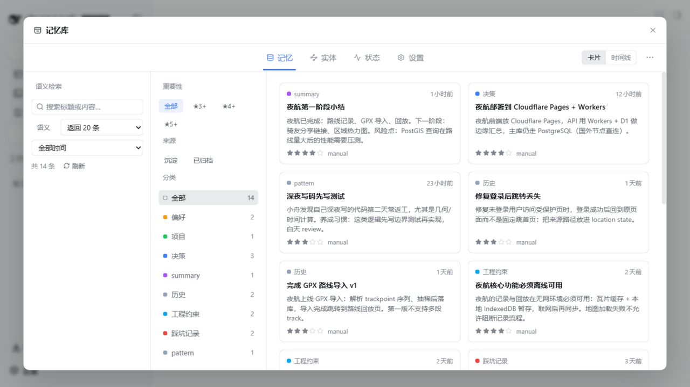
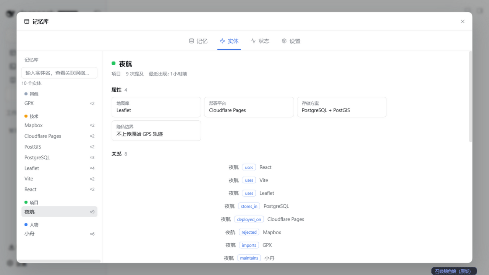
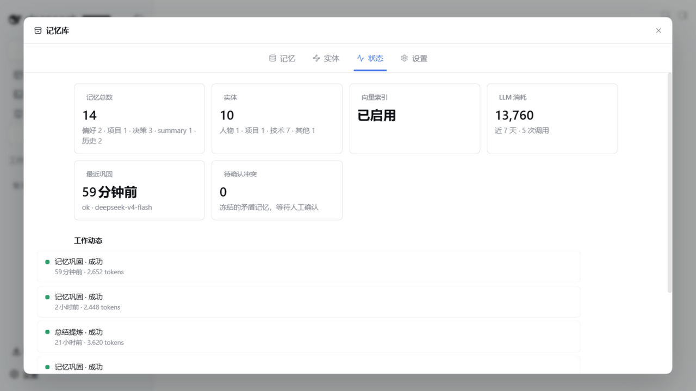
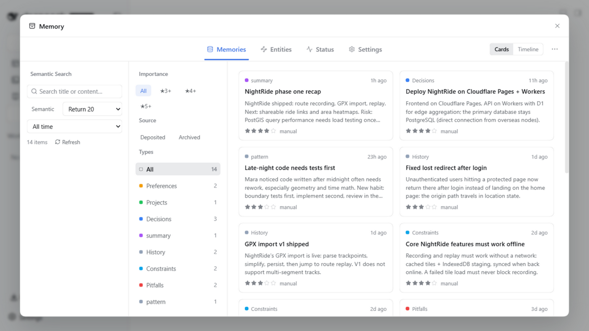
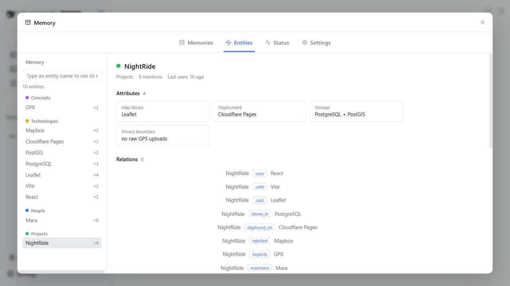
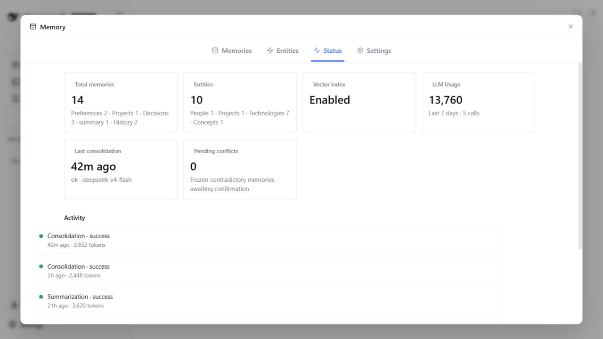

# 界面截图 / Screenshots

> 这些是面板截图，**可能落后于最新版本**。面板每改一次，这里的图就该重截一次；README 首屏不放截图，就是为了不让整页跟着 UI 一起过期。
> These are panel screenshots and **may lag behind the latest UI**. README keeps them out of the first screen so the page doesn't rot with every panel change.

## 中文

   
  <i>记录、浏览与筛选你的记忆。</i>

   
  <i>从记忆里提炼实体，构建带属性的关系图谱。</i>

   
  <i>向量索引、LLM 消耗、自动巩固记录，一眼看完。</i>

## English

   
  <i>Record, browse and filter your memories.</i>

   
  <i>Entities are distilled from your memories into a relation graph with attributes.</i>

   
  <i>Vector index, LLM spend and consolidation activity at a glance.</i>

