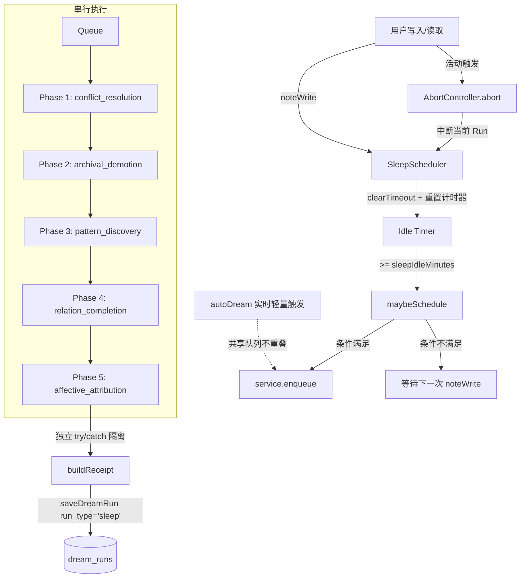

# dsh-mneme Sleep Mode 系统级睡眠设计文档

## 概述
从被动整理到主动维护：在系统空闲时段自动执行深度记忆压缩、冲突消解、模式发现与关系补全，实现知识库的长效健康治理。

## 动机与设计原则
- **非侵入性**：仅在用户空闲（Idle）时触发，不干扰正常读写与实时推理。
- **可中断**：用户一旦产生活动，立即中止当前睡眠周期，保障实时体验。
- **分层压缩**：按访问热度与时间衰减进行阶梯式降级，保留核心语义，释放存储压力。
- **模式发现**：利用 LLM 挖掘长期记忆中的隐性规律，生成结构化 Pattern 实体。
- **审计延续**：与 `autoDream` 共享 `dream_runs` 审计表，通过 `run_type` 区分，保障全链路可追溯。

## 架构图

## 配置项说明
| 配置项 | 默认值 | 说明 |
|:---|:---|:---|
| `sleepModeEnabled` | `false` | 全局开关（Opt-in），开启后激活调度器 |
| `sleepIdleMinutes` | `5` | 连续无操作触发睡眠的阈值（分钟） |
| `sleepMinIntervalHours` | `8` | 两次 Sleep Run 的最小时间间隔（小时） |
| `sleepFailureBackoff` | `false` | 连续失败退避（#529，opt-in）：有效间隔 = `sleepMinIntervalHours` × 2^连败数，成功清零，封顶 `max(sleepMinIntervalHours, 24h)`（配得比 24h 大就按配的算——退避只放大间隔，不压缩用户自己设的基数）。判据看整轮 `status === "failed"`——`noop`（通路正常、只是没活干）不算失败，否则在自己工作良好的库里也会越退越长 |
| `sleepConflictMaxPairs` | `12` | **单批**送审的冲突对上限（0 = 不限，回退旧行为） |
| `sleepConflictMaxPairsPerRun` | `60` | **单轮**最多送审多少对（0 = 不限）。与上一条分工：一个管批次大小、一个管整轮总量 |
| `sleepConflictStrictness` | `'normal'` | 冲突消解严格度：`'gentle'`(0.92) / `'normal'`(0.85) / `'aggressive'`(0.75) |
| `sleepArchiveDays` | `30` | 进入冷存储/摘要降级的天数阈值 |
| `sleepCompressDays` | `90` | 进入完全归档（Archive）的天数阈值 |
| `sleepPatternMinMemories` | `100` | 模式发现阶段扫描的最近记忆条数下限 |
| `sleepPatternLookbackDays` | `30` | 模式发现回溯的时间窗口（天） |
| `sleepMaxPatternPerRun` | `3` | 单次运行最多创建的模式数量上限 |
| `sleepAffectiveEnabled` | `false` | 情感归因相位（#619，opt-in）：情境情绪写成 `affective_context` 关系，跨多次独立会话的稳定倾向才铸成 pattern。是 `sleepModeEnabled` 的子相，父开关关着整个 sleep 不跑 |
| `sleepAffectiveTraitMinSessions` | `3` | 判「稳定倾向」所需的**独立会话**数（2–10）。下界 2 是故意的：N=1 就是单次场合，正是必须禁止升成特质的那个情形 |
| `sleepAffectiveMaxRelationsPerRun` | `10` | 单轮最多写多少条 `affective_context` 关系（0–50，0 = 一条不写） |
| `sleepProvider` | `''` | 睡眠模式专用 LLM Provider（留空则复用默认） |
| `sleepModel` | `''` | 睡眠模式专用 LLM Model（留空则复用默认） |
| `sleepReasoningEffort` | （未配置） | 睡眠 LLM 推理强度透传：`off` / `low` / `medium` / `high` / `none`。未配置 = 自动取模型支持的最低档（#135：避免思考模型用自带默认档烧光预算返回空体）；显式 `none` = 不传该字段，使用模型默认（与 `dreamReasoningEffort` 语义一致） |
| `sleepMaxTokens` | `8192` | 冲突消解与模式发现阶段的 LLM 输出预算上限（token，#257：原硬编码 2048——`sleepActionSet: full` 实测 24 对需约 7000，截断即整轮裁决失败）。流式计费按实际用量，调大不增加成本 |

## 五阶段详解
每个阶段独立包裹 `try/catch`，任一阶段失败仅跳过该阶段，不阻塞后续流程。四个相位读取的记忆行池都先剔掉 `source='imported'` 的外来行（`src/dream/sleep.js`）——外来行不经本方蒸馏与召回，时间分层与冲突判据在它身上系统性失真，我方对它的原文和归档面没有处置权，所以下文「输入」一栏里的「全量」一律读作「本方活跃行」，契约见 [SHARE.md](SHARE.md)。

### 1. `conflict_resolution`（冲突消解）
- **目标**：清理向量空间中的重复、矛盾或过时记忆。
- **输入**：全量/增量记忆向量索引、`sleepConflictStrictness` 阈值。
- **算法**：
  1. 向量检索 `findPotentialConflicts` 获取高相似度对；`sleepActionSet: "full"` 时再补一遍跨类型对。
  2. **已裁决对先压掉**：`differentiated_pairs` 账本里记着「这一对判过"互补、两条都留"」，两侧正文的 `content_hash` 与记账时一致就不再送模型（任一侧被改写则重新进候选）。这一轮被压掉几对记在 `phase.suppressed`，与「一对都没检测到」（`no conflicts found`）分开报。
  3. **台账预筛**（#529）：查 `conflict_reviewed`，把「已经判过、且两侧 `updated_at` 都不晚于 `judged_at`」的对从候选池里剔掉——它们上一轮已有结论，两侧都没动就没必要再问一遍。任一字段更新即重新入池（与 `conflict_pending` 复核项 4 同一条宽松代理）。两条边界：跨 scope 对**不筛**（它们本来就要停车进人工队列，不能被机器台账吞掉），`conflictFreezeEnabled` 档**不筛**（那一档只停车不送 LLM）。
  4. **去重**：每条记忆至多参与一对，相似度高者优先。**必须排在 3 之后**——先占位再去掉，一个已审的对会把它那一端记忆的配对名额占住，而它真正的对手（另一条没审过的记忆）因此进不了这一轮。被台账挡下的对数记在 `phase.ledgerSkipped`。
  5. **每轮总量上限**（`sleepConflictMaxPairsPerRun`，默认 60）：没进这一轮的对留在下一轮，既不丢也不记账。
  6. **分批**（`sleepConflictMaxPairs`，默认 12）：每批单独一次 LLM 往返、单独 `validateDecisions` + `applyDecisions`。某批撞上下文或输出坏掉只让**这一批**失败并计入 `degraded`，其余批照常落地；只有一批都没成功才整轮 `failed`。
  7. LLM 仲裁：基于严格度阈值生成决策（默认档 `keep/merge/conflict/create/archive/update`，full 档另开 `supersede/differentiate`）。
  8. `validateDecisions`：严格校验决策合法性，缺省策略为 `keep`。**`reflectionUpdateMaxPerRun` 是整轮上限，不是每批上限**——额度由分批循环持有，每批只领剩余额度，校验通过后按本批通过校验的 `update` 数扣减；额度耗尽的那批若还含 `update` 会被校验器整单拒绝（记 `failed`），其余批照常继续。
  9. `applyDecisions`：批量执行状态变更。
  10. **台账记账**：本批**全部送审对**都写一行 `conflict_reviewed`（不只记被裁决成冲突的那几对，判 `keep` 的正是下一轮重复送审的元凶），`outcome` 取两端里非 `keep` 的那一侧。记账是幂等 upsert，按 `(memory_a, memory_b)` 排序归一化。两个防"假已审"的细节：`judged_at` 取**发送本批之前**的时刻（不是落地之后——LLM 往返期间若一侧被外部改动，它的 `updated_at` 会晚于 `judged_at`，下一轮自然重新入池；按落地时刻封盘等于用陈旧结论锁死这一对），且取 `max(墙钟, 本批两侧最新的 updated_at)`——`updated_at` 用的是 store 的**单调时钟**（`src/store.js` 的 `nowIso` 在同一毫秒内的连续写入上逐次 +1ms），它可能领先墙钟几毫秒，两列不同源的话 `alreadyJudged` 会把「刚判过」读成「判过之后又被改过」，判 `keep` 的死循环原样复活；本批 `failures` / `conflicts`（CAS 冲突）/ `skipped` 里出现过的 id，其所在对**不记账**——没落地的裁决记成已审，会让这一对从此不再送审，沉默地永久压制一个真实冲突。
- **`differentiate` 不改正文**（#533）：`#126` 曾把同一段差异注记**同时**追加到两侧，指望注记进 embedding 后下一轮不再判重复。离线复现证伪了这个假设——两侧共享同一段后缀会让两条向量**同向靠拢**（余弦 0.876 → 0.960 只用 5 轮，注记截到 0 字照样往上爬），于是同一对每轮又被判成重复、又追加一段（实测单条堆到 19 段，正文 150 字膨胀到 2200+）。现在只落 `differentiated_pairs` 账本（配对 + 两侧当时的 `content_hash` + 模型给的 `distinctions`），正文一个字节都不动。存量库里仍带旧注记块的行按「已裁决」处理，升级不清账。
- **输出**：冲突消解报告（决策明细 + `pairs` / `batches` / `ledgerSkipped` / `perRunSkipped`）。**失败轮同样带 `pairs` 与 `batches`**——此前只有成功路径带，85 条失败审计行连"送了多少对"都查不到。批间被用户活动打断时报 `aborted`（不是 `noop`：`noop` 的语义是"看过、没冲突"，而没送出去的批根本没看过），整轮 `deriveStatus` 也沿用同一个词，不再折回 `noop`。
- **验收**：无合法记忆被误删；仲裁结果符合配置的严格度阈值；决策可回滚。
- **为什么要有预算（#529 的现场）**：整池相似对一次拼进一个 prompt，实测单请求 **163,054** 输入 token（服务端 `--ctx-size` 163,840，占 99.5%），撞墙后按冷却重排，送进去的还是同一份输入，于是连续 **23 轮** `llm failed`；而 `keep` 当时是彻底的 no-op（不留痕），同一对每个冷却周期都被重新问一遍。三处一起改之后单请求降到 806–2,011 token、连续失败 23 轮 → 0 轮。
- **台账为什么不复用 `conflict_pending`**：那张表是**人工**待裁决队列，面板徽标数就是 `countConflictPending()`（`resolved_at IS NULL` 的行数）。机器每判一对写一行会把这个数字淹掉，人就再也看不出"有哪些待我裁决"。两张表分工：`conflict_pending` = 人要看，`conflict_reviewed` = 机器记账，零界面。

### 2. `archival_demotion`（归档降级）
- **目标**：按时间衰减对记忆进行分层压缩，释放热存储压力。
- **输入**：`last_accessed_at` 排序的记忆列表、`sleepArchiveDays`、`sleepCompressDays`。
- **算法**（纯规则、无 LLM，确定性执行）：
  - `>= sleepCompressDays`：调用 `setArchived` 完全归档。
  - `>= sleepArchiveDays && < sleepCompressDays`：调用 `demoteToSummary(m.id, 摘要, {minRefTimeMs: archiveCut})` 转为摘要态——原内容存入 `_full_content`，摘要由前 120 字截断生成（LLM 未配置时的 fallback）。
  - `< sleepArchiveDays`：保持原状不动。
  - **minRefTimeMs 关键点**：传入快照时刻 `archiveCut`，`demoteToSummary` 在事务内复查 `last_accessed_at`——快照后被召回 touch 的记忆视为"重新活跃"，跳过不降级。
- **输出**：降级操作清单与状态快照。
- **验收**：严格遵循分层阈值；`minRefTimeMs` 机制生效，防止快照后 `touch` 导致的误降级；摘要保留 `_full_content` 可无损恢复。

### 3. `pattern_discovery`（模式发现）
- **目标**：从近期记忆中提炼可复用的隐性规律或知识模式。
- **输入**：最近 `sleepPatternLookbackDays` 内的 `sleepPatternMinMemories` 条记忆。
- **算法**：
  1. LLM 扫描分析，提取候选模式。
  2. **证据校验**：强制 `evidence` 列表与数据库真实 ID 求交集（`intersect`），过滤伪造/幻觉引用。
  3. 输出 `type=pattern` 创建指令，受 `sleepMaxPatternPerRun` 限制。
- **输出**：新创建的 Pattern 实体及关联证据链。
- **验收**：无孤立证据；Pattern 创建数不超上限；证据 100% 可溯源。

### 4. `relation_completion`（关系补全）
- **目标**：修复知识图谱中的断链与孤立节点。
- **输入**：`listEntities` 获取的实体列表、关系图谱。
- **算法**：
  1. 筛选 `getRelations` 返回为空的孤立实体。
  2. 基于上下文推断关系：
     - 语义/实体共现 → `related_to`
     - 同属项目/模块 → `part_of`
     - 技术栈/流程依赖 → `depends_on`
  3. 批量写入关系边。
- **输出**：新增关系边列表。
- **验收**：关系推断符合领域常识；不引入循环依赖；图谱连通性提升。

### 5. `affective_attribution`（情感归因，#619）
- **目标**：把「谁在什么场合因为什么而有情绪」写成图上的一条边，并且**不**让一次性的情绪升格成「他就是这种人」。
- **输入**：实体列表（`listEntities`，至少 2 个），扫描池口径与模式发现一致（`sleepPatternMinMemories`、剔除 document/summary/pattern、剔除 imported、剔暂停项）；`sleepAffectiveTraitMinSessions`、`sleepAffectiveMaxRelationsPerRun`。
- **算法**：
  1. 开关 `sleepAffectiveEnabled !== true` → `skipped: disabled`；无 LLM 路由 → `skipped: no llm route`；实体不足 2 个 → `skipped: too few entities`。
  2. LLM 读实体名清单 + 记忆列表，每条候选输出 `person` / `target` / `emotion` / `attribution`（`occasion` 或 `trait`）/ `evidence`（记忆 id）/ `why`。
  3. **护栏在代码里，不在 prompt 里**：`person`/`target` 必须解析到已存在的实体（否则丢进 `dropped: unknown entity`）；`evidence` 必须是本轮扫描池里的真实 id（否则 `no real evidence`）；`emotion` 非空。
  4. **升特质要过 provenance**：模型说 `trait`，就用 `service.provenanceFor(memoryId)` 收集这批 evidence 覆盖的 `session_id`，去重后数量 `< sleepAffectiveTraitMinSessions` 的一律**降级为 `occasion`**（记 `downgradedFrom: "trait"`，不丢弃）。被降级的条数就是这张探针要抓的误归因数——静默丢掉它就等于把测到的东西藏起来。
  5. `occasion` 落边：先按**会话**判是不是同一个场合，再决定合并还是新写。`entity_relations` 没有 UNIQUE 约束，`saveRelation` 每次都是新插一条，而探针会拿同一批段反复回放——不判重就会把同一次场合叠成多条边、把 `sessionCount` 抬得比真实场合数高。但**判重不能按 evidence 有没有交集**：模型给 evidence 的顺序不稳定（`parseJsonArray` 也不排序），`[m1,m2]` 与 `[m2,m1]` 是同一场合的两种写法；同一会话里的两条不同记忆各说一句「他很焦虑」，证据天然不相交，可它们是同一个场合。所以键落在会话层：同一 `(person, target, emotion)` 且两边**会话集**有交集 ⇒ 同一场合。
     - 命中 ⇒ **合并而不是丢弃**：把 evidence 并集、按并集重算的 `sessionCount` 写回既有边（`updateRelationMetadata`），`lastMergedRunId` 记下是哪一轮补的，并计入返回值 `merged`。只丢弃会让边上的场合数冻结在第一次写入那一刻，将来拿它算归因覆盖率会一直读到 1。
     - 未命中且未超 `sleepAffectiveMaxRelationsPerRun` ⇒ `saveRelation({relation_type: "affective_context", source: "llm", memory_id: evidence[0], metadata: {emotion, attribution, why, evidence, sessionCount, model, runId}})`；超出的进 `dropped: relation cap`。合并发生在 cap 之前——合并既有边不新增行，不该占名额。
  6. `trait` 走**标准决策通道**——铸成 `type=pattern` 记忆，经 `validateDecisions`（`allowedActions: ["create"]`、`maxCreatePerRun` 取 `sleepMaxPatternPerRun`）与 `applyDecisions`（`mintSource: "sleep"`，带 #512 铸造台账）。不新增写路径，因此继承所有既有上限与审计。**标题必须含 `target`**：`applyCreate` 走 `service.saveWithDedupe`，按 `(type, title)` 找同题行；标题不含对象时，「对答辩长期焦虑」与「对面试长期焦虑」是同一条，第二条会被静默合并——不报错、不进 `failures`，而 `applied` 仍如实显示写了，等于一条真实结论被吞掉而返回值说它已落库。**pattern 走 `_overwrite` 原地刷新、不追加**：`applyCreate` 对 `type === "pattern"` 传 `_overwrite: true`，命中同题行时正文被整体替换（旧文进 `content_history`，`source: "overwrite"`）。不这样的话，重放同一批证据会把同一段结论一遍遍 `appendContent` 粘上去（实测 161 → 355 → 549 字，外加一串重复的 `[证据: …]` 尾巴），而 pattern 正是注入面消费的东西。只对 pattern 放开——其他类型被 `create` 撞上同题行时仍按合并语义走，整段覆盖既有行比追加更危险。
  7. `applyCreate` 命中同题行时 `saveWithDedupe` 返回 `action: "merged"`：它确实刷新了那一行，但**没有铸出新条目**。这种结局不计入 `applied`，单独计 `merged` 并返回 `refreshedTraits`；决定 `status` 时它既不是 `ok`（没有新铸）也不是 `noop`（确实动过库），单独报 `refreshed`。`deriveStatus` 把 `refreshed` 算作「有产出」，否则整轮会被记成 noop，审计行又变回「跑了、什么都没干」。
  8. 已存在的 `occasion` 边在同类情绪被确认为 `trait` 时**不改写、只标记**：边记录的是「这次场合观察到过」，这句话在升格后仍然为真，所以 `sessionCount` 保持原值；但会给它写上 `promotedToTrait: true` 与 `traitSessionCount`。不标的话，同一件事实在图上写着「一次性」、在 pattern 里写着「长期」，读归因覆盖率的人拿到两份互相矛盾的记录，而且不会自愈——边不参与 trait 判定（trait 只看当轮 evidence）。
- **输出**：`{status, scanned, relations, merged, mergedList, edgeWrites, applied, refreshedTraits, failures, conflicts, traits, downgraded, dropped}`。`downgraded` 与 `dropped` 必须都是可见数字。`edgeWrites`、`merged`、`refreshedTraits` 各自单独报，因为它们都不是 `applied` 决策：第一个是「新写了一条边」，第二个是「认出了同一场合、把证据补进既有边」，第三个是「trait 标题撞上既有 pattern、原地刷新了它」。混进 `applied` 会让两个数字的含义随相位漂移，也会让「一条真实结论被同题行吃掉」看起来像成功。但 **receipt 里三者都算**——`buildReceipt` 只回答「这一轮到底改动过库没有」，只累加 `applied` 会让「写了边的一轮」和「只做了合并的一轮」都读成 `:0`，也就是「跑了但什么都没做」，那正是探针绝不能看到的状态。receipt 保持八段不变（`parseReceipt` 与 `organize.js` 共用这条契约），明细在各相位的 `phases` JSON 里，不在 receipt 里。
- **每条返回路径都带全字段**：`aborted` 与 `failed` 两个分支同样有 `merged` 与 `mergedList`。少一个不会报错，消费方读到 `undefined` 会静默当作「没有合并」——审计面上最难查的就是这种。
- **中断与失败**：中途 `signal.aborted` ⇒ `status: "aborted"`（**即使一条都没写**——循环断在任意下标，没扫完就不能报 `noop` 说「池子是空的」）；`validateDecisions` 拒绝 trait 决策 ⇒ `status: "failed"`，不是静默的 `noop`。
- **验收**：一次场合的情绪只能落 `affective_context` 边、不能铸 pattern；同一类型跨 N 个独立会话才允许铸 pattern；判为 `related_to` 的关系计数在本相位后不增长；同一批段重放不产生第二条相同边（而是合并进既有边）；重放时把 evidence 数组换个顺序也不产生第二条边；同一会话里两条不同记忆说的是同一种情绪时合并成一条边、`sessionCount` 仍是 1；后面又攒到新会话时既有边被扩充、`sessionCount` 跟着涨而不是冻结；同一条记忆里的两种不同情绪必须是两条边；只做了合并的一轮，receipt 的写入计数不为 0；同一个人对两个不同对象各够 trait 阈值时铸出**两条** pattern（不许一条吞掉另一条）；重放同一批证据三轮，pattern 正文长度与 `[证据]` 尾巴个数都不变；只做了原地刷新的那一轮报 `refreshed` 而不是 `ok` + `applied: 0`；`occasion` 边在升格 trait 后被标上 `promotedToTrait` 而 `sessionCount` 不变。
- **为什么不能接在 `relation_completion` 里**：那一相只扫**孤立**实体（`getRelations(e.id).length === 0`），且 `inferRelationType` 三种类型硬编码、末行 `return "related_to"` 兜底——把情感塞进去只会得到一批 `related_to`，图上看不出情感轴。

## 分层压缩策略表
| 记忆层级 | 判定条件 (`last_accessed_at`) | 处理策略 | 存储形态 |
|:---|:---|:---|:---|
| **活跃 (Active)** | `< sleepArchiveDays` | 保持原状，正常搜索可见 | 全文索引 + 向量 |
| **冷 (Cold)** | `>= sleepArchiveDays` 且 `< sleepCompressDays` | `demoteToSummary` 压成摘要，原文进 `_full_content` | 摘要 + `_full_content` 分离 |
| **睡眠 (Archived)** | `>= sleepCompressDays` | `setArchived` 移出热查询域 | 仅保留元数据与归档标记 |

## 调度器与可中断机制
- **`noteWrite()` 心跳重置**：每次用户写入/读取记忆时触发。必须先 `clearTimeout` 清除旧计时器，再重新设置 Idle Timer，彻底杜绝 Stale Timer 导致的误触发。
- **`maybeSchedule()` 准入控制**：串行检查 `sleepModeEnabled` → 空闲时长 `>= sleepIdleMinutes` → 距上次运行 `>= 有效最小间隔` → 状态非 `running/disposed`。任一不满足则放弃调度。
  - **有效最小间隔**（#529）：`sleepFailureBackoff` 关（默认）时逐字节等于 `sleepMinIntervalHours`；开启时按连续失败次数指数推迟，封顶 `max(sleepMinIntervalHours, 24h)`——不是硬 24h：基数允许配到 168 小时，那时封顶跟着基数走，退避只能放宽间隔、不会把用户设的基数压小。`armNextWindow()` 排下一次闹钟用的是同一个函数——两处口径必须一致，否则退避期闹钟会在基数到点响、被 `shouldRun` 否掉、再重排一次，白转一轮。
  - 退避**不是**按"同一份输入又失败"判的：`runSleep` 里那个 `snapshotHash` 是跑完之后对 `phases` 结果算的摘要哈希，不是输入快照，拿它当判据会把"同样的输入"认成"不同的结果"。改用连续失败计数，与 `autoDream` 的失败退避（#292）同构。
- **`service.enqueue` 串行队列**：所有 Sleep Run 必须进入全局串行队列执行，与 `autoDream` 严格互斥，避免并发写入冲突与资源争抢。
- **`AbortController` 可中断**：调度器持有 AbortController 实例。一旦检测到用户活动（`noteWrite` 或显式交互），立即调用 `abort()` 中断当前 `runSleep` 的执行上下文，保证实时性优先。

## 数据迁移与存储层变更
- **幂等迁移**：
  - `memories` 表新增列：`last_accessed_at` (DATETIME)、`_full_content` (TEXT/BLOB)。
  - `dream_runs` 表新增列：`run_type` (VARCHAR, 默认 'auto'，用于区分 'sleep')。
  - 迁移脚本需保证幂等（`IF NOT EXISTS` / 检查列是否存在）。
- **Store 新增方法**：
  - `demoteToSummary(id, summary, opts)`：执行降级并记录 `minRefTimeMs`。
  - `restoreContent(id)`：按需从归档/摘要恢复原文。
  - `touchLastAccess(id)`：更新 `last_accessed_at` 至当前时间。
  - `getUnrecalledSince(days)`：按时间窗口拉取未召回记忆。
  - `listEntities()`：获取实体列表用于关系分析。
- **Service 扩展**：
  - `enqueue(task)`：串行任务队列入口。
  - `setSleepHook(fn)`：注入 `noteWrite` 钩子。
  - `touchRecalled(id)`：在召回路径中自动更新访问时间。

## 与 autoDream 的协作关系
| 维度 | autoDream (实时) | Sleep Mode (系统级) |
|:---|:---|:---|
| **触发时机** | 写入阈值/实时事件 | 系统空闲 + 定时周期 |
| **执行深度** | 轻量级、局部关联补全 | 深度扫描、全局压缩与模式提炼 |
| **资源占用** | 低延迟、短时 | 允许较高延迟、长时运行 |
| **队列关系** | 共享 `service.enqueue` 串行队列 | 共享 `service.enqueue` 串行队列（严格互斥不重叠） |
| **审计记录** | 共用 `dream_runs`，`run_type='auto'` | 共用 `dream_runs`，`run_type='sleep'` |

## 实现要点与避坑（v0.4.1 教训）
1. **Stale Timer 防护**：`noteWrite()` 中必须严格遵循 `clearTimeout(oldTimer) -> setNewTimer()` 顺序，否则快速连续写入会累积多个 Timer 导致频繁误触发。
2. **`minRefTimeMs` 防误降级**：调用 `demoteToSummary` 时必须传入快照时刻 `{minRefTimeMs: archiveCut}`。否则在 Sleep Run 执行期间被用户 `touch` 的记忆会因时间窗口漂移被错误降级。
3. **证据强过滤**：Pattern Discovery 阶段 LLM 返回的 `evidence` 必须与 DB 真实 ID 列表求交集。未通过 `intersect` 校验的证据一律丢弃，严防幻觉伪造关联。
4. **严格串行化**：所有 Sleep Run **必须**走 `service.enqueue`。禁止直接调用异步函数启动，确保与 `autoDream` 绝对不重叠，避免写入锁冲突。
5. **Fail-Safe 阶段隔离**：各阶段必须各自独立 `try/catch`。LLM 服务抖动或网络异常时，仅跳过当前阶段（如跳过 Pattern 发现），后续阶段（如 Demotion、Relation、Affective）必须继续执行并记录 Receipt。
6. **无 LLM 降级路由**：当 `resolveSleepRoute` 返回 `undefined`（如 Provider 未配置或模型不可用）时，系统应自动跳过所有依赖 LLM 的阶段，但 `archival_demotion`（纯规则）仍需照常执行，保障基础压缩能力不丢失。

## 测试清单
- [ ] **调度器**：验证 `sleepIdleMinutes` 触发准确性；验证 `clearTimeout` 防 Stale；验证 `sleepMinIntervalHours` 冷却生效。
- [ ] **中断机制**：运行中触发 `noteWrite`，验证 `abort()` 立即终止 Run 且状态回滚至安全点。
- [ ] **阶段隔离**：Mock LLM 500 错误，验证仅对应阶段跳过，Receipt 仍生成且 `run_type='sleep'`。
- [ ] **降级策略**：构造不同 `last_accessed_at` 的记忆，验证 `minRefTimeMs` 防误降级逻辑及分层归档正确性。
- [ ] **模式发现**：注入含虚假 ID 的 LLM 响应，验证 `intersect` 过滤生效且创建数 `<= sleepMaxPatternPerRun`。
- [ ] **情感归因（#619）**：单会话证据判 `trait` → 必须降级为 `occasion` 且 `downgraded` 计数 +1；跨 N 个独立会话才铸 pattern；`related_to` 计数在本相位后不增长；未知实体/伪造 evidence 进 `dropped` 而不是静默消失。
- [ ] **迁移幂等**：重复执行迁移脚本，验证无报错、无重复列/数据。
- [ ] **队列互斥**：并发触发 `autoDream` 与 Sleep，验证 `service.enqueue` 串行执行无重叠。

## 启用指南（Opt-in）
1. **配置开启**：在 `config.js` 或环境变量中设置 `sleepModeEnabled: true`。
2. **资源评估**：建议生产环境配置独立的 `sleepProvider` 与 `sleepModel`，避免与实时推理争抢额度/并发。
3. **初始运行**：首次启用后，系统将在首次空闲 `>= sleepIdleMinutes` 时触发全量扫描。可通过查看 `dream_runs` 表中 `run_type='sleep'` 的记录监控执行结果。
4. **调优建议**：初期可设置 `sleepConflictStrictness: 'gentle'`，观察 `conflict_resolution` 决策准确率后再逐步收紧至 `'normal'` 或 `'aggressive'`。
5. **关闭恢复**：设置 `sleepModeEnabled: false` 后，调度器将在 `dispose()` 阶段清理 Timer 并释放 Hook，已归档数据可通过 `restoreContent` 按需恢复。